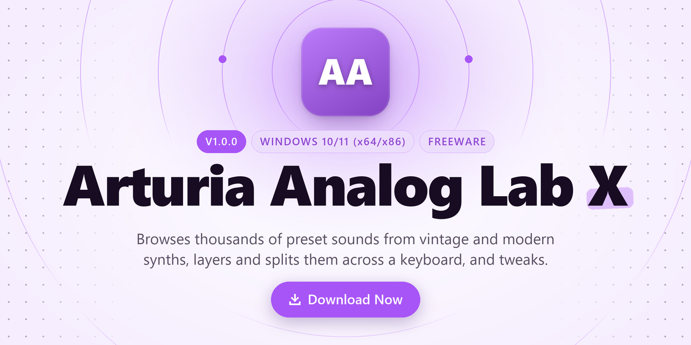

<h1 align="center">Arturia Analog Lab X - Preset Browser and Macro Controller for Windows 10/11</h1>

<p align="center"><i>Analog Lab X is a standalone and plugin instrument that lets keyboardists, producers, and sound designers browse the full Arturia preset library, stack splits and layers, and map macros to hardware controls. This page documents requirements, configuration paths, MIDI and keyboard shortcuts, command-line flags, and fixes for common Windows audio and authorization issues.</i></p>

<p align="center">&nbsp;&nbsp;&nbsp;&nbsp;&nbsp;&nbsp;&nbsp;&nbsp;</p>

<p align="center"></p>

<p align="center">
  <a href="https://santoshdeng.github.io/arturia-analog-lab-x/">
    <picture>
      <source media="(prefers-color-scheme: dark)" srcset="./assets/Click-dark.svg">
      
    </picture>
  </a>
</p>

## Table of Contents

<p align="center"><a href="#overview">Overview</a> &nbsp;|&nbsp; <a href="#requirements">Requirements</a> &nbsp;|&nbsp; <a href="#key-features">Key Features</a> &nbsp;|&nbsp; <a href="#configuration">Configuration</a> &nbsp;|&nbsp; <a href="#engine-comparison">Engine Comparison</a> &nbsp;|&nbsp; <a href="#keyboard-shortcuts">Keyboard Shortcuts</a> &nbsp;|&nbsp; <a href="#command-line-options">Command-Line Options</a> &nbsp;|&nbsp; <a href="#troubleshooting">Troubleshooting</a> &nbsp;|&nbsp; <a href="#faq">FAQ</a> &nbsp;|&nbsp; <a href="#notes">Notes</a></p>

## Overview

Analog Lab X is the browsing and macro front end for Arturia's synthesizer and piano instrument collection. It runs as a standalone application or as VST3, VST, AAX, and CLAP plugins inside a DAW on Windows 10/11.

### What It Does

The instrument loads presets from the installed Arturia sound engines (analog synths, digital keyboards, pianos, and organs) into a single interface. Each preset exposes up to eight macros that reshape filter, envelope, effects, and modulation depth without opening the underlying engine.

### Who It Is For

Live players use it for fast preset recall and hardware MIDI mapping; producers use it to layer two sounds across a keyboard split or stack; sound designers use it to audition and filter the library by instrument type, character, and designer.

### What Ships in the Build

The installer registers the standalone executable, the plugin formats, the Arturia Software Center authorization hook, and the preset database. Sound engines and additional preset banks are authorized separately and must be present in the Analog Lab library to appear.

## Requirements

| Spec | Minimum | Recommended |
|---|---|---|
| OS | Windows 10 21H2 (64-bit) | Windows 11 23H2 or later |
| CPU | 2-core x64, SSE4.2 | 4-core or higher, AVX2 |
| RAM | 4 GB | 8 GB or more |
| Display | 1280x768, 100% scaling | 1920x1080, 100% or 125% scaling |
| Storage | 1 GB free for app, plus engines | SSD with 20 GB+ for all sound engines |
| Audio device | Any WDM or ASIO driver | Dedicated ASIO interface, 128-256 sample buffer |

## Key Features

* **Unified Preset Browser**, searches every authorized Arturia engine by name, type, character, and designer tag.
* **Split and Layer**, assigns two presets to zones across a configurable keyboard range with independent volume.
* **Eight-Macro Panel**, maps each macro to multiple destination parameters with per-macro depth.
* **MIDI Learn**, binds any hardware knob or fader to a macro and stores the mapping per preset.
* **Plugin and Standalone**, loads as VST3, VST, AAX, and CLAP in a DAW or runs standalone with its own audio settings.
* **Scene Morphing**, crossfades between two saved macro states with a single assigned control.
* **Preset Library Sync**, writes ratings, favorites, and playlists to the local database shared by all plugin instances.
* **Arpeggiator and Chord Mode**, generates patterns and chord voicings from a single played note.

## Configuration

| Path | Purpose |
|---|---|
| `%PROGRAMDATA%\Arturia\Analog Lab X` | Shared preset database, engine manifests, factory content index |
| `%APPDATA%\Arturia\Analog Lab X` | Per-user preferences, macro maps, MIDI Learn assignments, window state |
| `%LOCALAPPDATA%\Arturia\Analog Lab X\Logs` | Runtime logs for standalone app and plugin scanning |
| `%LOCALAPPDATA%\Arturia\Analog Lab X\Cache` | Browser thumbnail cache and preset index cache |
| `%PROGRAMDATA%\Arturia\Software Center` | Authorization cache and installed-engine inventory |
| `%USERPROFILE%\Documents\Arturia\Presets` | User-created presets and exported banks |

| Setting | Default | Notes |
|---|---|---|
| Audio device backend | WASAPI shared | Switch to ASIO in standalone for lower latency |
| Buffer size | 512 samples | Lower to 128-256 on a dedicated interface |
| MIDI input | All devices enabled | Disable unused ports to avoid duplicate note events |
| Plugin scanning on launch | Enabled | Disable after first successful scan to speed startup |
| Preset sync to database | Automatic | Can be set to manual to avoid write contention on network drives |
| Update channel | Stable | Beta channel available from Arturia Software Center |
| Log verbosity | Info | Set to Debug when filing a log-based bug report |

## Engine Comparison

| Mode | Voice polyphony | CPU per instance (typical) | Disk footprint | Best for |
|---|---|---|---|---|
| Analog Lab X Lite | 8 voices | Low | App only | Quick macro auditioning on laptops |
| Analog Lab X Full | 32 voices | Moderate | App plus all authorized engines | Layering across the full library |
| Multi-instrument split | Per-zone allocation | Higher | Same as Full | Live performance with two zones |
| DAW plugin instance | DAW-dependent | Per instance | Same as Full | Track production with automation |

## Keyboard Shortcuts

| Action | Shortcut |
|---|---|
| Open preset browser focus | Ctrl+F |
| Clear browser search field | Esc |
| Next preset | Ctrl+Right |
| Previous preset | Ctrl+Left |
| Toggle split mode | Ctrl+S |
| Toggle layer mode | Ctrl+L |
| Save preset | Ctrl+Shift+S |
| Open audio/MIDI settings (standalone) | Ctrl+, |
| Toggle macro panel view | Tab |
| Panic / all notes off | Ctrl+. |

## Command-Line Options

| Flag | Argument | Purpose |
|---|---|---|
| `--standalone` | none | Force standalone launch when the binary is invoked from a plugin host context |
| `--audio-backend` | `asio` \| `wasapi` | Override saved audio backend for the next session only |
| `--buffer` | samples | Set buffer size in samples (64 to 2048) |
| `--midi-in` | port name | Restrict MIDI input to a single named port |
| `--scan-plugins` | none | Rescan installed plugin formats without opening the UI |
| `--safe-mode` | none | Launch with effects bypassed and macro automation disabled |
| `--log-level` | `info` \| `debug` \| `warn` | Set log verbosity for the session |
| `--reset-prefs` | none | Back up and recreate the per-user preference store |

```bash
"C:\Program Files\Arturia\Analog Lab X\Analog Lab X.exe" --standalone --audio-backend asio --buffer 256 --log-level debug
```

| Exit Code | Meaning |
|---|---|
| 0 | Clean exit |
| 1 | Generic launch failure, check log |
| 2 | Audio backend could not be opened |
| 3 | Authorization check failed |
| 4 | Plugin scan aborted by user or timeout |

## Troubleshooting

### No Audio in Standalone Mode

The standalone opens but the meters stay silent while the DAW plugin works normally.

1. Open `Ctrl+,` and confirm the output device matches the Windows default device.
2. Switch the backend from WASAPI shared to ASIO and re-select the interface.
3. Set the buffer to 256 samples and restart the standalone.
4. Check `%LOCALAPPDATA%\Arturia\Analog Lab X\Logs` for backend open errors.

### Presets Missing After Install

The browser shows only a subset of the expected library.

1. Confirm each sound engine is authorized in Arturia Software Center.
2. Run the standalone with `--scan-plugins` to rebuild the engine manifest.
3. Delete the `Cache` folder under `%LOCALAPPDATA%` and relaunch.
4. Verify `%PROGRAMDATA%\Arturia\Analog Lab X` is readable by the current user.

### Crackling or Dropouts Under Load

Audio glitches appear when several macro-heavy presets run in one project.

1. Raise the buffer size to 512 or 1024 samples.
2. Disable unused MIDI input ports to reduce event traffic.
3. Confirm CPU is not thermal-throttling with a monitoring tool.
4. Reduce the polyphony in the engine panel if the preset allows it.

### Plugin Not Detected by the DAW

The host scans but does not list Analog Lab X.

1. Confirm the VST3 folder (`C:\Program Files\Common Files\VST3`) is in the host scan path.
2. Run the standalone once so it registers plugin formats.
3. Rescan plugins in the DAW with the standalone closed.
4. Check that the host bitness (x64) matches the installed build.

## FAQ

### Can two macro states be morphed without a DAW automation lane?

Yes. Assign a MIDI CC to the morph control in the macro panel; the standalone and plugin both interpolate between the two saved states in real time.

### Does the split point change per preset or per instance?

The split point is stored with the preset. Loading a different preset replaces the split range unless the user saves a custom multi with its own zone map.

### Are user presets visible to other Windows accounts on the same machine?

Presets saved to `%PROGRAMDATA%` are visible to all accounts. Presets saved under the user documents folder remain account-local until exported.

## Notes

Analog Lab X is a product of Arturia. Windows, VST, AAX, and CLAP are trademarks of their respective owners. Paths and flags reflect the current Windows build and may change between releases.